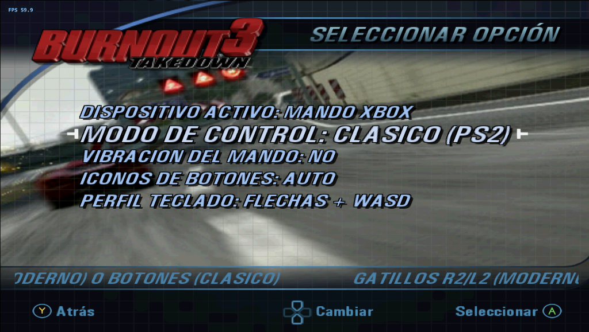
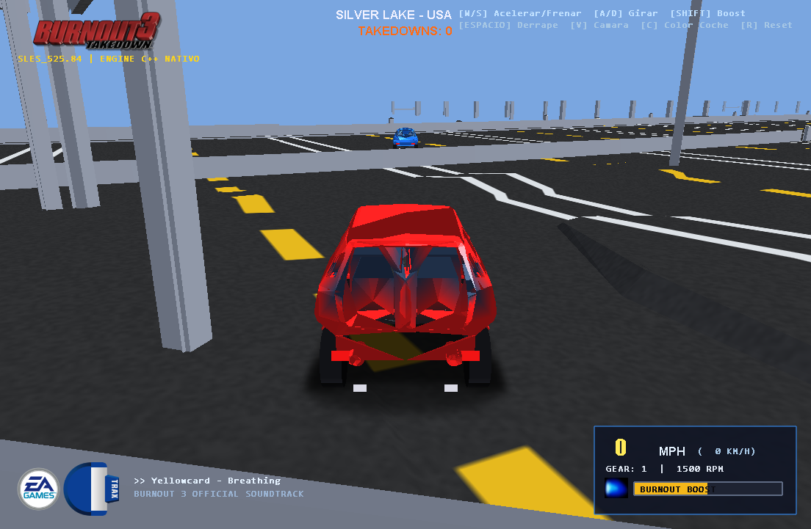
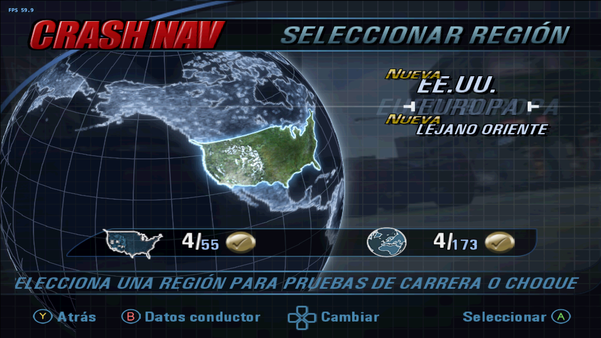
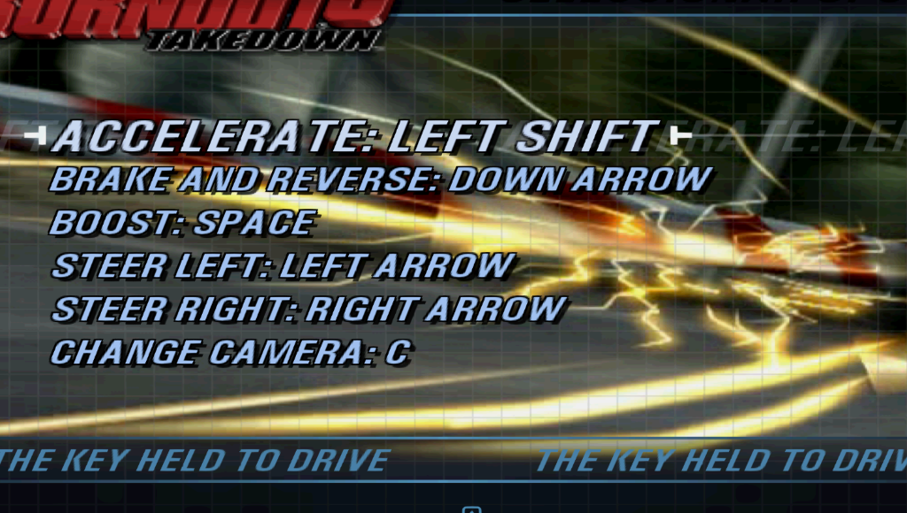
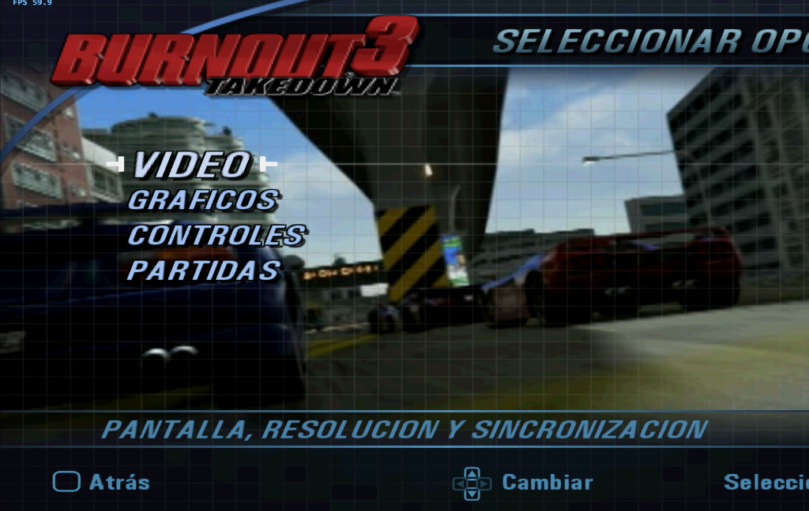
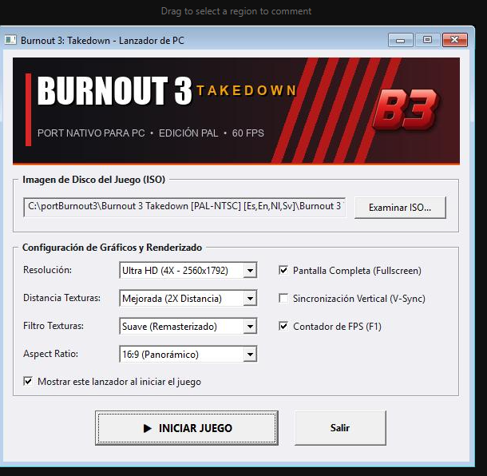

# Project Takedown: Burnout 3 Takedown (PAL) - Native PC Port (v1.0)

[](https://github.com/Maxiargomedo/Project-Takedown)
[-blue.svg)](https://github.com/Maxiargomedo/Project-Takedown)
[](https://github.com/Maxiargomedo/Project-Takedown/releases)
[](LICENSE)

---

### 🌐 Select Language / Selecciona Idioma
**[🇬🇧 English Version](#-english-version)** | **[🇪🇸 Versión en Español](#-versión-en-español)**

---

## 📸 Screenshots & Showcase / Capturas de Pantalla

<div align="center">

### 🏎️ 60 FPS Native Racing & Widescreen (16:9)


### 💥 Authentic Crash Mode & Enhanced Visuals


### ⚙️ Integrated PC Settings & Custom Installer
| 🛠️ PC Settings Menu | 🖥️ Advanced Video Settings |
|:---:|:---:|
|  |  |

| 🎮 Keyboard & Controller Mapping | 📦 Win32 Standalone Installer |
|:---:|:---:|
|  |  |

</div>

---

# 🇬🇧 English Version

**Burnout 3: Takedown (PAL - SLES-52584) Version 1.0 running natively on Windows PC.**  
This is not emulation: the PS2 game code was translated into native C++ and compiled for x64, delivering a locked 60 FPS, true 16:9 widescreen presentation, up to 4K internal resolution scaling, integrated in-game PC settings, modern gamepad layouts (Xbox & PlayStation triggers), keyboard remapping, mouse navigation, and an all-in-one standalone installer.

### 💾 Download Installer (v1.0)
👉 **[CLICK HERE TO DOWNLOAD (Instalador_Burnout3_PC.exe)](https://raw.githubusercontent.com/Maxiargomedo/Project-Takedown/main/releases/Instalador_Burnout3_PC.exe)**  
*(Direct high-speed download, no compilation required).*

### 🚀 Quick Start
1. Run `Instalador_Burnout3_PC.exe`.
2. Choose your installation destination (default: `C:\Juegos\Burnout 3 Takedown PC`).
3. Launch the game and select your own legally dumped **Burnout 3: Takedown PAL ISO (`SLES-52584`)**. Enjoy!

### 🌟 Credits & Special Acknowledgements
> This project builds upon the groundbreaking work of **[danielgomesvieira2000/burnout3-pc](https://github.com/danielgomesvieira2000/burnout3-pc)** and the **ps2-port-engine**.  
> Huge thanks to Daniel Gomes Vieira for making the decompilation and C++ translation framework possible. This repository expands upon that foundation by targeting the European PAL release (multi-language), fixing menu routing and double-click quirks, adding modern trigger driving and classic layouts, and packaging everything into a clean standalone installer.

### ✨ Key Features in Version 1.0
- **Full European PAL Support**: Multi-language support for Spanish, English, French, German, and Italian.
- **Fixed & Enhanced PC Settings**:
  - Smooth Up/Down arrow navigation, Enter to confirm, Esc to return.
  - Button-release drain to prevent double-click or accidental option triggers.
  - **Skip Intro Videos**: Automatically skips introductory logo videos straight to the title screen, or skip at any time with Start.
  - Organized Video Menu: Fullscreen toggle, VSync, Internal Resolution up to 4x, Aspect Ratio (16:9 / 4:3), Anti-Aliasing (FXAA, SMAA, SSAA 2x).
  - Persistent Speed Blur setting saved to `pc_settings.ini`.
- **Modern & Classic Controls**:
  - **Modern Driving**: Accelerate & brake with analog triggers (RT/LT or R2/L2).
  - **Classic Driving**: Original PS2 face buttons (Cross / Square) and shoulder boost.
  - **Mouse Menu Support**: Left-click to select, right-click to go back, wheel scroll.
  - In-game keyboard key remapping with Spanish & English UI.
  - Full controller rumble / vibration support.
- **Self-Contained Engine**: The `engine/` source is directly integrated without broken submodule dependencies.

### 🎮 Default Controls

#### Menu Navigation
| Action | Keyboard / Mouse | Gamepad (Xbox / PlayStation) |
|---|---|---|
| Navigate Options | Arrow Keys (Up / Down / Left / Right) | D-Pad or Left Analog Stick |
| Select / Confirm | Enter / Left Mouse Click | A (Xbox) / Cross (PS) |
| Back / Cancel | Esc / Right Mouse Click | B (Xbox) / Circle (PS) |
| Pause Game | Esc / Enter | Start |

#### Modern Driving Mode (Triggers)
| Action | Keyboard | Xbox Controller | PlayStation Controller |
|---|---|---|---|
| **Accelerate** | W / Up Arrow | **Right Trigger (RT)** | **R2 Trigger** |
| **Brake / Reverse** | S / Down Arrow | **Left Trigger (LT)** | **L2 Trigger** |
| **Steering** | A / D or Left / Right Arrows | Left Analog Stick | Left Analog Stick |
| **Boost** | Space / Left Shift | Button A | Cross Button (✖) |
| **Handbrake** | Space / Left Ctrl | Button X | Square Button (■) |
| **Look Back** | Key C | Button Y | Triangle Button (▲) |
| **Change Camera** | Key V | Button B | Circle Button (●) |
| **Next Track** | Key B | Left Bumper (LB) | L1 Button |

#### Classic Driving Mode (Original PS2 Layout)
| Action | Keyboard | Xbox Controller | PlayStation Controller |
|---|---|---|---|
| **Accelerate** | W / Up Arrow | **Button A** | **Cross Button (✖)** |
| **Brake / Reverse** | S / Down Arrow | **Button X** | **Square Button (■)** |
| **Steering** | A / D or Left / Right Arrows | Left Analog Stick | Left Analog Stick |
| **Boost** | Space / Left Shift | **Button RB / RT** | **Button R1 / R2** |
| **Handbrake** | Space / Left Ctrl | Left Trigger (LT) | L1 Button |
| **Look Back** | Key C | Left Bumper (LB) | L1 Button |
| **Change Camera** | Key V | Button Y | Triangle Button (▲) |
| **Next Track** | Key B | View Button | L2 Button |

---

# 🇪🇸 Versión en Español

**Burnout 3: Takedown (PAL - SLES-52584) Versión 1.0 ejecutándose de forma nativa en PC con Windows.**  
No es emulación: el código del juego de PS2 fue traducido a C++ nativo y compilado para x64, alcanzando 60 FPS estables, soporte para pantallas panorámicas (16:9), escalado hasta 4K, menú de ajustes de PC integrado, soporte completo para teclado, ratón y mandos modernos (Xbox, PlayStation DualShock/DualSense), y un instalador autónomo listo para usar.

### 💾 Descarga del Instalador (v1.0)
👉 **[DESCARGAR INSTALADOR DIRECTO (Instalador_Burnout3_PC.exe)](https://raw.githubusercontent.com/Maxiargomedo/Project-Takedown/main/releases/Instalador_Burnout3_PC.exe)**  
*(Descarga directa de alta velocidad, no requiere compilar nada).*

### 🚀 Guía Rápida de Instalación
1. Ejecuta `Instalador_Burnout3_PC.exe`.
2. Elige la carpeta de instalación (por defecto: `C:\Juegos\Burnout 3 Takedown PC`).
3. El instalador configurará los accesos directos y los archivos necesarios.
4. Al abrir el juego por primera vez, selecciona tu copia de la ISO de **Burnout 3: Takedown (PAL / SLES-52584)**. ¡Y a correr!

### 🌟 Créditos y Reconocimientos Especiales
> Este proyecto fue posible gracias a la extraordinaria base y trabajo pionero de:
> - **[danielgomesvieira2000/burnout3-pc](https://github.com/danielgomesvieira2000/burnout3-pc)** y el motor **ps2-port-engine**.  
> Nuestro más sincero agradecimiento a Daniel Gomes Vieira por hacer posible la ingeniería inversa y traducción de Burnout 3 a C++. Este repositorio amplía su legado adaptándolo a la versión europea PAL (multilenguaje), corrigiendo fallos de navegación, menús de PC, controles y empaquetándolo en un instalador fácil para la comunidad.

### ✨ Características de la Versión 1.0
- **Edición PAL Europea completa**: Soporte para idiomas Español, Inglés, Francés, Alemán e Italiano.
- **Instalador Nativo Win32 integrado**: Con detección inteligente de instalaciones previas, reparación automática y desinstalación limpia.
- **Menú de Ajustes PC corregido y ampliado**:
  - Navegación impecable con flechas arriba/abajo, Enter para confirmar y Esc para volver atrás.
  - Drenaje anti doble-click para evitar activaciones accidentales.
  - Opción de **Saltar Videos Intro** de forma automática o con botón Start.
  - Opciones de video ordenadas: Pantalla completa, VSync, Resolución interna (hasta 4x), Relación de aspecto (16:9 / 4:3), Anti-Aliasing (FXAA, SMAA, SSAA 2x).
  - Persistencia asegurada para el desenfoque de velocidad (*Speed Blur*) en `pc_settings.ini`.
- **Soporte de Controles Modernos y Clásicos**:
  - Modos de conducción: **Clásico** (Cruz/Cuadrado o A/X) y **Moderno** (Aceleración y freno con gatillos RT/LT o R2/L2).
  - Navegación con Mouse: Selección con clic izquierdo, retroceso con clic derecho y scroll con rueda del ratón.
  - Reasignación de teclas para teclado con interfaz traducida al español.
  - Soporte de vibración (*rumble*) para mandos Xbox y PlayStation.
- **Motor integrado**: El motor `engine/` viene incorporado directamente en el repositorio sin dependencias rotas de submódulos.

### 🎮 Controles por Defecto

#### Menús y Navegación
| Acción | Teclado / Ratón | Mando (Xbox / PlayStation) |
|---|---|---|
| Moverse por opciones | Flechas Arriba / Abajo / Izq / Der | Cruceta (D-Pad) o Stick Izquierdo |
| Aceptar / Seleccionar | Enter / Clic Izquierdo | A (Xbox) / Cruz (PS) |
| Retroceder / Cancelar | Esc / Clic Derecho | B (Xbox) / Círculo (PS) |
| Pausa | Esc / Enter | Start |

#### Conducción: Modo Moderno (Gatillos)
| Acción | Teclado | Mando Xbox | Mando PlayStation |
|---|---|---|---|
| **Acelerar** | W / Flecha Arriba | **Gatillo Derecho (RT)** | **Gatillo R2** |
| **Frenar / Reversa** | S / Flecha Abajo | **Gatillo Izquierdo (LT)** | **Gatillo L2** |
| **Dirección** | A / D o Flechas Izq / Der | Stick Izquierdo | Stick Izquierdo |
| **Boost (Turbo)** | Espacio / Shift Izquierdo | Botón A | Botón Cruz (✖) |
| **Freno de Mano** | Espacio / Ctrl | Botón X | Botón Cuadrado (■) |
| **Mirar Atrás** | Tecla C | Botón Y | Botón Triángulo (▲) |
| **Cambiar Cámara** | Tecla V | Botón B | Botón Círculo (●) |
| **Siguiente Canción** | Tecla B | Botón LB | Botón L1 |

#### Conducción: Modo Clásico (Original de PS2)
| Acción | Teclado | Mando Xbox | Mando PlayStation |
|---|---|---|---|
| **Acelerar** | W / Flecha Arriba | **Botón A** | **Botón Cruz (✖)** |
| **Frenar / Reversa** | S / Flecha Abajo | **Botón X** | **Botón Cuadrado (■)** |
| **Dirección** | A / D o Flechas Izq / Der | Stick Izquierdo | Stick Izquierdo |
| **Boost (Turbo)** | Espacio / Shift Izquierdo | **Botón RB / RT** | **Botón R1 / R2** |
| **Freno de Mano** | Espacio / Ctrl | Gatillo Izquierdo (LT) | Botón L1 |
| **Mirar Atrás** | Tecla C | Botón LB | Botón L1 |
| **Cambiar Cámara** | Tecla V | Botón Y | Botón Triángulo (▲) |
| **Siguiente Canción** | Tecla B | Botón Blanco / View | Botón L2 |

*(Nota: Puedes alternar entre Modo Clásico y Modo Moderno o reasignar las teclas desde el menú `AJUSTES PC > CONTROLES` dentro del juego).*

---

## 🛠️ Compilación desde el Código Fuente / Building from Source

### Requisitos / Requirements
- Windows 10 / 11 (64-bit)
- Visual Studio 2022 (MSVC C++ x64)
- CMake 3.24+
- Vulkan SDK 1.3

### Pasos / Build Steps
```powershell
# 1. Clone repository
git clone https://github.com/Maxiargomedo/Project-Takedown.git
cd Project-Takedown

# 2. Configure with CMake
cmake -B build -S . -G "Visual Studio 17 2022" -A x64

# 3. Build executable
cmake --build build --config Release
```

The compiled binary will be placed at `build/games/burnout3_pal/port/Release/burnout3_pal.exe`.

Para recompilar el instalador Win32:
```powershell
cd installer
build_installer.bat
```

---

## ⚖️ Legal Notice / Nota Legal

Este repositorio **no contiene material con derechos de autor**, archivos binarios de la BIOS ni imágenes ISO originales de PlayStation 2. Para jugar se requiere una copia legítima del disco **Burnout 3: Takedown (PAL / SLES-52584)**.  
*Burnout* is a registered trademark of Electronic Arts Inc. This project is for historical preservation and interoperability purposes, not affiliated with or endorsed by Electronic Arts or Criterion Games.
